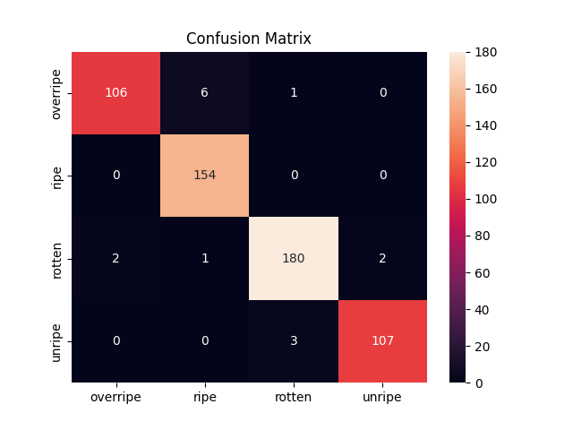
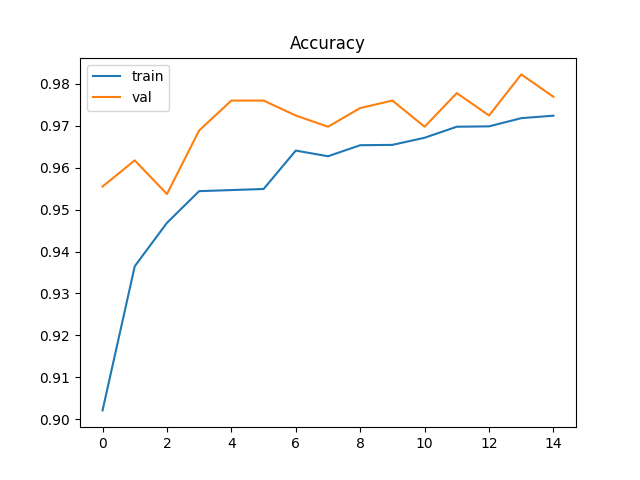

# Fruit Ripeness Grading: A CNN-based Image Classifier

CNN-based image classifier that grades banana ripeness from surface images into
four classes: **unripe, ripe, overripe, rotten**. Built with MobileNetV2 transfer
learning and delivered as a Streamlit produce-sorting line assistant.

## Keywords
fruit, ripeness, grading, cnn, image, classifier

## Dataset
Banana Ripeness Classification Dataset (Kaggle):
https://www.kaggle.com/datasets/shahriar26s/banana-ripeness-classification-dataset

| Split | Images |
|-------|--------|
| Train | 11,793 |
| Validation | 1,123 |
| Test | 562 |

## Model
- Base model: MobileNetV2 (ImageNet pretrained, frozen)
- Input size: 224 x 224
- Augmentation: random flip, rotation, zoom
- Head: GlobalAveragePooling, Dropout(0.3), Dense(128, ReLU), Dense(4, Softmax)
- Optimizer: Adam (lr = 0.001), loss: categorical cross-entropy
- Training: 15 epochs with early stopping

## Results
Test accuracy: **97%** (562 test images)

| Class | Precision | Recall | F1-score |
|-------|-----------|--------|----------|
| overripe | 0.98 | 0.94 | 0.96 |
| ripe | 0.96 | 1.00 | 0.98 |
| rotten | 0.98 | 0.97 | 0.98 |
| unripe | 0.98 | 0.97 | 0.98 |

## Run the app
pip install -r requirements.txt
streamlit run app.py

Upload a banana image and the app shows its ripeness grade with confidence.

## Files
- `app.py` : Streamlit web app (sorting line assistant)
- `train.py` : model training and evaluation code
- `fruit_ripeness.keras` : trained model
- `classes.json` : class names
- `requirements.txt` : dependencies
